# DATABASE_SCHEMA.md — Canonical data design, ingestion, indexing

> Design only. The real catalogue schema is **unknown** (UNK-01…UNK-06) and so is the policy format (UNK-07). Everything that depends on them is expressed as configuration in `config/catalogue_mapping.yaml` and verified on Day 1 with `scripts/inspect_inputs.py`. Nothing here has been run.

## 1. Principles

1. **Never invent values.** A missing or invalid field becomes `NULL` plus a recorded issue. No defaults, no imputation, no "reasonable" guesses.
2. **Identity errors quarantine the row; field errors null the field.** A product without a reliable ID or title cannot be cited and is quarantined. A bad price makes the price unavailable but the product remains.
3. **Raw preserved.** The original record is stored as JSON (`raw_json`) for audit; the canonical columns are derived.
4. **Reproducible build.** Same inputs + config + model ⇒ same IDs, same `content_digest`, same vector ID order.
5. **Read-only at runtime.** The server opens SQLite with `mode=ro` and never writes.

## 2. Canonical product schema

| Canonical field | Type | Nullable | Source (UNK) | Rules |
|---|---|---|---|---|
| `product_id` | TEXT | **No** | UNK-05 | Must match `product_id_regex` (config; must not contain `:`); unique after dedupe; case-sensitive; trimmed |
| `title` | TEXT | **No** | UNK-01 | Non-empty after trim; control chars removed |
| `description` | TEXT | Yes | UNK-01 | Missing → `NULL` + `DESCRIPTION_MISSING` |
| `category` | TEXT | Yes | UNK-01 | Trimmed display value; `category_norm` = NFKC lowercase, single spaces |
| `category_path` | TEXT (JSON array) | Yes | UNK-01 | Only if categories are hierarchical (separator in config) |
| `price_minor` | INTEGER | Yes | UNK-02 | Integer minor units (e.g. paise) parsed with `decimal.Decimal`; must be >0 unless `allow_zero_price: true`; ≥0 always |
| `currency` | TEXT | Yes | UNK-02 | From a source field, or `assume_currency` set **explicitly** in config. If neither → ingestion fails the Day 1 gate (no silent assumption) |
| `rating` | REAL | Yes | UNK-06 | Within `[rating_min, rating_max]` from config (assume 0–5 only until confirmed); out of range → `NULL` + `RATING_OUT_OF_RANGE` |
| `rating_count` | INTEGER | Yes | UNK-06 | ≥0 if the field exists; else `NULL` (never invented) |
| `stock_status` | TEXT enum | **No** (`UNKNOWN` allowed) | UNK-03 | `IN_STOCK` \| `OUT_OF_STOCK` \| `UNKNOWN` |
| `stock_quantity` | INTEGER | Yes | UNK-03 | Only if the source has a quantity field |
| `attributes` | rows in `product_attributes` | n/a | UNK-04 | See §5 |
| `suspicious_text` | INTEGER 0/1 | No | — | 1 if title/description/attributes match instruction-like patterns (`ingest/sanitizer.py`) |
| `source_row` | INTEGER | No | — | 1-based row/record number in the source |
| `content_hash` | TEXT | No | — | SHA-256 of canonical JSON of the record (duplicate detection, digest) |
| `raw_json` | TEXT | No | — | Original record, exactly as read |

The hackathon states the catalogue contains title, description, attributes, price, stock status, category and ratings. **A brand field is not listed**, so none is modelled. Brand/model words are found lexically in titles, descriptions and attributes.

## 3. Mapping configuration (`config/catalogue_mapping.yaml`)

Illustrative skeleton — **keys on the left are the contract; the values on the right are placeholders to be filled from the real data on Day 1**:

```yaml
source:
  format: csv            # csv | json | jsonl  (UNK-01)
  encoding: utf-8
  path: data/raw/<catalogue file>
fields:                  # canonical -> source field name(s), first non-empty wins
  product_id: [<source id column>]
  title: [<source title column>]
  description: [<source description column>]
  category: [<source category column>]
  price: [<source price column>]
  currency: []           # empty = not in source
  rating: [<source rating column>]
  rating_count: []
  stock: [<source stock column>]
  stock_quantity: []
  attributes: [<source attributes column>]
product_id_regex: "^[A-Za-z0-9_.-]{1,40}$"      # confirm against real IDs; ':' forbidden
price:
  thousands_separator: ","                       # confirm
  decimal_separator: "."                         # confirm
  strip_tokens: ["₹", "Rs.", "Rs", "INR"]
  assume_currency: null                          # set to "INR" ONLY after confirming (UNK-02)
  allow_zero_price: false
rating: { min: 0.0, max: 5.0 }                   # confirm (UNK-06)
stock:
  value_map:                                     # raw value (lowercased, trimmed) -> enum; fill from distinct values
    "<raw value A>": IN_STOCK
    "<raw value B>": OUT_OF_STOCK
  from_quantity: false                           # if true: qty>0 IN_STOCK, qty==0 OUT_OF_STOCK
attributes:
  format: dict                                   # dict | list_of_pairs | json_string | delimited_text | free_text (UNK-04)
  pair_separator: ";"                            # for delimited_text
  kv_separator: ":"
  multi_value_separators: []                     # empty = never split values
category:
  hierarchy_separators: []                       # e.g. [">", "/"] if hierarchical
```

If `attributes.format: free_text`, no structured attributes exist; attribute claims can only use `DESCRIPTION_TEXT` basis.

## 4. Validation, quarantine and field issues

### 4.1 Row-level (quarantine) — row excluded from all indexes

| Code | Condition |
|---|---|
| `MISSING_ID` | No product ID |
| `INVALID_ID_FORMAT` | ID fails `product_id_regex` |
| `MISSING_TITLE` | Title empty after trim |
| `DUPLICATE_ID_CONFLICT` | Same `product_id` appears in ≥2 rows whose `content_hash` differ → **all** rows with that ID quarantined (no unreliable price is ever shown) |
| `UNPARSEABLE_ROW` | Row cannot be read/mapped |

Quarantined rows go to table `quarantine` and `data/build/quarantine.jsonl` with reason and `raw_json`. The Day 1 gate: **quarantine count and reasons are reviewed by a human**; if conflicting duplicates exist, the team decides (keep-first vs quarantine) with the organisers' guidance and logs it in `docs/DECISIONS.md`.

### 4.2 Field-level (set `NULL`, keep row) — recorded in `field_issues`

| Code | Condition |
|---|---|
| `PRICE_MISSING`, `PRICE_UNPARSEABLE`, `PRICE_NEGATIVE`, `PRICE_ZERO` | Price absent, not parseable as an exact decimal with ≤2 fractional digits, <0, or =0 when zero not allowed. Ranges ("100–200"), "from 100", NaN/inf are unparseable. |
| `CURRENCY_UNKNOWN` | Price present but no currency source and no `assume_currency` |
| `RATING_MISSING`, `RATING_UNPARSEABLE`, `RATING_OUT_OF_RANGE` | As named |
| `STOCK_MISSING`, `STOCK_UNRECOGNIZED` | Stock set to `UNKNOWN` |
| `CATEGORY_MISSING`, `DESCRIPTION_MISSING` | As named |
| `ATTR_UNPARSEABLE` | Attribute blob cannot be parsed (structured attributes absent for that row) |

Rounding is never applied to "fix" a price: `129.999` is `PRICE_UNPARSEABLE`, not `13000`.

### 4.3 Duplicates

| Case | Handling |
|---|---|
| Identical `product_id` and identical `content_hash` | Keep one (lowest `source_row`), log `DUPLICATE_EXACT_DROPPED` |
| Identical `product_id`, different content | Quarantine all (above) |
| Different `product_id`, identical title+category (near duplicate) | **Keep all**; recorded in `build_report.json` as `near_duplicate_groups`. They are different products; the ambiguity detector will force a clarification if a shopper refers to one by name. |

## 5. Attribute normalization

`product_attributes` stores one row per (product, key, value):

- `key_raw`, `value_raw`: as read.
- `key_norm`: NFKC → lowercase → trim → replace runs of space/`_`/`-` with `_` → apply **only listed** synonym mappings from `config/attribute_synonyms.yaml` (e.g. `colour → color` once the team confirms both occur). Unlisted keys are never merged.
- `value_norm`: NFKC → lowercase → trim → collapse whitespace.
- `value_num` and `unit`: set only when the value matches `^\s*(\d+(\.\d+)?)\s*([A-Za-z"%]+)?\s*$` and the unit is in a configured unit table (e.g. `gb, tb, kg, g, cm, mm, inch, l, ml, w, mah`). No cross-unit conversion unless the unit table lists an exact factor.
- Values are split into several rows only when `multi_value_separators` is configured.
- If a product has repeated keys, all values are kept.

Attribute **verification** at query time (`retrieval/attribute_verifier.py`):
1. `STRUCTURED` match: `key_norm`/`value_norm` equal (or `value_num` + `unit` equal for numeric constraints).
2. `DESCRIPTION_TEXT` match (allowed only if `verifier.allow_description_text: true`, default true): the value appears as a whole word in `description` **and** no negation cue occurs in the 3 tokens before it (`no, not, non, without, free of, -free` — config list). Evidence field = `description`, claim basis = `DESCRIPTION_TEXT`.
3. Title match counts as text evidence with field `title`.
No fuzzy or semantic confirmation, ever.

## 6. Stock representation

`stock_status` ∈ {`IN_STOCK`, `OUT_OF_STOCK`, `UNKNOWN`}. "Only in stock" filters `stock_status='IN_STOCK'`; `UNKNOWN` products are excluded and counted in `SearchManifest.excluded_unknown_stock` (surfaced as warning `UNKNOWN_STOCK_EXCLUDED`). UI labels: "In stock", "Out of stock", "Stock status not available".

## 7. SQLite DDL (build output `data/build/truthcart.sqlite`)

```sql
PRAGMA journal_mode=OFF; PRAGMA foreign_keys=ON;

CREATE TABLE catalogue_meta (key TEXT PRIMARY KEY, value TEXT NOT NULL);

CREATE TABLE products (
  pid            INTEGER PRIMARY KEY,                 -- assigned in sorted product_id order (stable)
  product_id     TEXT NOT NULL UNIQUE,
  title          TEXT NOT NULL,
  description    TEXT,
  category       TEXT,
  category_norm  TEXT,
  category_path  TEXT,                                -- JSON array or NULL
  price_minor    INTEGER CHECK (price_minor IS NULL OR price_minor >= 0),
  currency       TEXT,
  rating         REAL,
  rating_count   INTEGER CHECK (rating_count IS NULL OR rating_count >= 0),
  stock_status   TEXT NOT NULL CHECK (stock_status IN ('IN_STOCK','OUT_OF_STOCK','UNKNOWN')),
  stock_quantity INTEGER,
  suspicious_text INTEGER NOT NULL DEFAULT 0,
  attributes_text TEXT NOT NULL DEFAULT '',           -- "key: value; key: value" for FTS/embedding
  source_row     INTEGER NOT NULL,
  content_hash   TEXT NOT NULL,
  raw_json       TEXT NOT NULL
);
CREATE INDEX idx_products_category ON products(category_norm);
CREATE INDEX idx_products_price    ON products(price_minor);
CREATE INDEX idx_products_stock    ON products(stock_status);
CREATE INDEX idx_products_rating   ON products(rating);

CREATE TABLE product_categories (                      -- one row per path level (flat catalogue: level 0 only)
  product_id TEXT NOT NULL REFERENCES products(product_id),
  level INTEGER NOT NULL, name_norm TEXT NOT NULL,
  PRIMARY KEY (product_id, level)
);
CREATE INDEX idx_pc_name ON product_categories(name_norm);

CREATE TABLE product_attributes (
  product_id TEXT NOT NULL REFERENCES products(product_id),
  key_raw TEXT NOT NULL, key_norm TEXT NOT NULL,
  value_raw TEXT NOT NULL, value_norm TEXT NOT NULL,
  value_num REAL, unit TEXT,
  PRIMARY KEY (product_id, key_norm, value_norm)
);
CREATE INDEX idx_attr_kv ON product_attributes(key_norm, value_norm);
CREATE INDEX idx_attr_v  ON product_attributes(value_norm);

CREATE VIRTUAL TABLE products_fts USING fts5(
  title, description, category, attributes_text,
  tokenize = 'porter unicode61 remove_diacritics 2'    -- rowid = products.pid
);

CREATE TABLE field_issues (
  product_id TEXT NOT NULL, field TEXT NOT NULL, code TEXT NOT NULL, detail TEXT,
  PRIMARY KEY (product_id, field, code)
);

CREATE TABLE quarantine (
  q_id INTEGER PRIMARY KEY, source_row INTEGER, product_id_raw TEXT,
  reason_code TEXT NOT NULL, detail TEXT, raw_json TEXT
);

CREATE TABLE policy_sections (
  section_id  TEXT PRIMARY KEY,                       -- document numbering if present, else 'S<ordinal 2 digits>'
  ordinal     INTEGER NOT NULL UNIQUE,
  level       INTEGER NOT NULL,
  heading     TEXT NOT NULL,
  parent_id   TEXT REFERENCES policy_sections(section_id),
  body        TEXT NOT NULL,                          -- verbatim text of the section
  topic       TEXT,                                   -- returns|shipping|warranty|NULL (keyword rule, config)
  char_start  INTEGER NOT NULL, char_end INTEGER NOT NULL,
  content_hash TEXT NOT NULL
);
CREATE VIRTUAL TABLE policy_fts USING fts5(heading, body, tokenize='porter unicode61 remove_diacritics 2'); -- rowid = ordinal

CREATE TABLE build_runs (
  run_id TEXT PRIMARY KEY, started_at TEXT, finished_at TEXT,
  durations_json TEXT, counts_json TEXT
);
```

FTS5 availability is probed at startup (`store/db.py`). If absent (UNK-12), `lexical.py` uses a pure-Python BM25 built from the same tables; the schema above still applies minus the FTS tables.

BM25 column weights (config): title 8.0, description 1.0, category 3.0, attributes_text 4.0.

## 8. Embedding index

- Document text for each product (template stored in `models.yaml: doc_template`, hash recorded in the manifest):
  `"{title}. Category: {category}. {attributes_text}. {description[:N]}"`, `N` from config (default 400). Any model-specific prefixes (UNK-08) are applied by the adapter, not the template.
- Files: `data/build/vectors.npy` (float32, shape `(n, dim)`, L2-normalised), `data/build/vector_ids.json` (list of `product_id` in row order = `pid` order).
- Loaded with `numpy.load(allow_pickle=False)`. Query-time search: `scores = M @ q` restricted to an eligible-ID mask; deterministic tie-break by `product_id`.
- If no embedder is available at build time, vectors are skipped and `manifest.vectors = null`; the system runs lexical-only (L2 in the degradation ladder).

## 9. Policy ingestion

`ingest/policy_parser.py` must preserve headings and IDs and never drop text:

1. Read text safely (size cap, UTF-8). Normalise line endings only.
2. **Heading detection strategies** (config `policy.heading_strategy`, chosen Day 1 after reading the file, UNK-07): `numbered` (`^\d+(\.\d+)*[.)]?\s+\S`), `markdown` (`^#{1,6}\s`), `caps` (ALL-CAPS short lines), `colon` (short line ending with `:` followed by a blank line), or `blank_line_paragraphs` (fallback).
3. Each section: `section_id` = the document's own number if present (`2.1`), else `S01`, `S02`… by ordinal; `heading` verbatim; `body` verbatim (including bullet lists); `parent_id` from numbering/level.
4. Long sections (> `max_section_chars`, default 1,500) are split at paragraph boundaries into children `S03.p1`, `S03.p2`, each keeping the parent heading and a `parent_id`.
5. `topic` assigned by keyword lists in `config/app.yaml: policy.topic_keywords` (team-authored from the real headings); `NULL` allowed.
6. **Coverage check**: concatenating `body` + `heading` text of all sections must cover ≥99% of non-whitespace characters of the source; otherwise the build fails.
7. Policy claims are made only by quoting a verbatim sentence span from a section (Tier 0) or, in Tier 2, paraphrasing with numbers/durations verified against that section. See `GROUNDING_AND_REFUSAL.md` D-09, D-10, V-08, V-09.
8. The policy document is **not** a product record: a general warranty statement is never recorded as a product's warranty.

## 10. Build pipeline (`scripts/build_index.py`)

```mermaid
flowchart LR
  A[read raw catalogue] --> B[map fields]
  B --> C[parse fields: price/rating/stock/attrs]
  C --> D[validate: quarantine + field issues]
  D --> E[dedupe]
  E --> F[assign pid in sorted order]
  F --> G[write SQLite + FTS5]
  G --> H[embed documents -> vectors.npy]
  H --> I[parse policy -> policy_sections + FTS]
  I --> J[write manifest + build_report]
```



`build_report.json` records: row counts (read, kept, quarantined by reason, near-duplicate groups), field-issue counts by code, per-stage durations (read, parse, db, fts, embed, policy), embedding model ID/dim, embedding throughput. **Indexing time is reported separately from query latency and never mixed.**

`build_manifest.json`:
```json
{ "schema_version": 1, "built_at_utc": "…",
  "inputs": { "catalogue_sha256": "…", "policy_sha256": "…" },
  "config": { "mapping_sha256": "…", "synonyms_sha256": "…", "aliases_sha256": "…", "doc_template_sha256": "…" },
  "content_digest": "sha256 over canonical sorted product rows + policy sections",
  "counts": { "products": 0, "quarantined": 0, "policy_sections": 0 },
  "vectors": { "model_id": "…", "dim": 0, "n": 0, "vectors_sha256": "…", "ids_sha256": "…" } }
```
At server start `verify_manifest` recomputes `content_digest` from the DB, and checks the vectors/ids hashes and the embedder `model_id`/`dim` against the manifest. Any mismatch ⇒ `INDEX_NOT_READY` (never silently serving a stale index).

## 11. Acceptance criteria

| ID | Criterion |
|---|---|
| DB-AC-01 | `inspect_inputs.py` output reviewed and `catalogue_mapping.yaml` filled; every UNK-01…UNK-06 answered in `DAY1_FINDINGS.md` |
| DB-AC-02 | Build is idempotent: two builds yield the same `content_digest`, the same `vector_ids.json`, and vectors equal within 1e-5 |
| DB-AC-03 | Every product row has a valid unique ID matching the regex; zero rows with `price_minor < 0` or rating out of range |
| DB-AC-04 | No canonical field ever holds a value that the source record does not contain (property test: re-derive each field from `raw_json`) |
| DB-AC-05 | Quarantine and field-issue counts are reported and each reason code has a unit test |
| DB-AC-06 | Policy parser coverage ≥99%, section IDs unique and stable across builds, headings preserved verbatim |
| DB-AC-07 | Runtime opens the DB read-only; a write attempt raises |
| DB-AC-08 | Changing one byte of the catalogue changes `catalogue_sha256` and the server refuses to start on a stale manifest |
