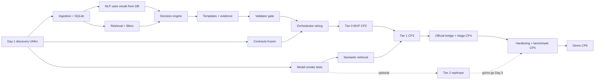

# IMPLEMENTATION_PLAN.md — Seven-day plan for four people, milestones, checkpoints

> Planning document. Nothing has been built; estimates are plans, not measurements. Durations assume the unknowns in `architecture.md` §10 are resolved on Day 1; if not, the fallback MVP (§7) applies.

## 1. Scope: mandatory vs optional

| ID | Feature | Tier | Status |
|---|---|---|---|
| F-01 | Ingestion, validation, quarantine, SQLite + FTS5, manifest | 0 | **Mandatory** |
| F-02 | Rule-based normalization, intent, constraints (price/stock/category/attribute/ID/rating/sort) | 0 | **Mandatory** |
| F-03 | Exact filtering, attribute verification, ambiguity, relaxation | 0 | **Mandatory** |
| F-04 | Decision engine D-01…D-17, claim planner, template generator, citations | 0 | **Mandatory** |
| F-05 | Validator V-01…V-12 + independent auditor | 0 | **Mandatory** |
| F-06 | Policy sections + retrieval + verbatim quotes + refusal | 0 | **Mandatory** |
| F-07 | Chat API, product/policy/meta/health endpoints | 0 | **Mandatory** |
| F-08 | UI: chat, cards, citations, clarification buttons, refusal blocks, constraint chips | 0 | **Mandatory** (scope depends on UNK-16) |
| F-09 | Dev set, evaluation runner, reports, offline test | 0 | **Mandatory** |
| F-10 | Supplied embedding model, vector index, RRF | 1 | **Mandatory** (lexical-only is the documented fallback) |
| F-11 | Multi-turn state, merger, clarification resolution | 1 | **Mandatory** (stretch goal in brief, treated as required here) |
| F-12 | Official evaluator bridge | 1 | **Mandatory** once UNK-10 resolved |
| F-13 | LLM rephrasing of validated claims + fallback | 2 | Recommended; **mandatory if UNK-13 says the instruction model must be used** |
| F-14 | LLM-assisted extraction, compare intent, ordinals, FAISS/Chroma swap, extended code-mix lexicon, description-only "uniform answer" option | 3 | Optional |
| F-15 | Evidence drawer, polished a11y beyond basics, Playwright | — | Optional (basic a11y in F-08 is mandatory) |

## 2. Ownership

| Member | Role | Owns (files) | Reviewer for |
|---|---|---|---|
| **1 — Backend & Catalogue** | Data and language front-end | `ingest/*`, `store/db.py`, `store/product_repo.py`, `store/policy_repo.py`, `nlp/*`, `routes_products/policy/meta`, `config/catalogue_mapping.yaml`, `attribute_synonyms.yaml`, `category_aliases.yaml`, `lexicons/*` | retrieval interfaces |
| **2 — Retrieval, Models & Grounding** | Core intelligence | `models/*`, `store/vector_index.py`, `retrieval/*`, `decision/*`, `generation/*` (incl. Tier 2), `config/decision_thresholds.yaml`, `models.yaml` | NLP outputs, validator |
| **3 — Frontend & API Integration** | Contracts and wiring | `schemas/*`, `api/*`, `container.py`, `orchestrator.py`, `conversation/*`, `frontend/*`, `main.py`, `settings.py` | API conformance |
| **4 — Evaluation, Testing, Integration & Demo** | Independent verification | `validation/*` (authored independently from generation), `metrics/*`, `eval/*`, `scripts/{inspect_inputs,gen_dev_set,run_eval,benchmark,check_offline,smoke_models}.py`, `tests/*`, CI, `docs/{DAY1_FINDINGS,DECISIONS,OFFICIAL_EVALUATOR_NOTES}.md`, demo | everything (red-team) |

Why this split: the validator is written by a different person than the generator; every member owns a contract; integration is distributed (see §6).

**Pairings** (daily 20-minute sync on the shared interface): 1↔2 (repo/vocab ↔ retrieval), 2↔3 (orchestrator wiring), 3↔4 (API/UI e2e), 4↔1 (ingestion gates), 4↔2 (validator vs generator red-team).

## 3. Day 1 verification checklist (all unknowns closed or owned)

| ID | Task | Closes | Owner | Output |
|---|---|---|---|---|
| D1-01 | Place hackathon inputs in `data/raw/` (read-only); record SHA-256 | — | 4 | `DAY1_FINDINGS.md` |
| D1-02 | Run `inspect_inputs.py` on the catalogue: format, field names, count, ID uniqueness and pattern, null counts per field, price representation and currency, stock distinct values, rating range, attribute representation, category values/hierarchy, near-duplicates, suspicious text | UNK-01…06 | 1 | filled `catalogue_mapping.yaml` draft |
| D1-03 | Read the policy: headings/numbering, sections, topics, length, statements about warranty vs product | UNK-07 | 1 | `policy.heading_strategy`, topic keywords |
| D1-04 | Embedding model smoke test (`smoke_models.py`): loads offline, name, dim, required prefixes, CPU throughput, determinism | UNK-08 | 2 | `models.yaml` embedder block |
| D1-05 | Instruction model smoke test: loads offline, runtime, context length, chat template, one short generation latency, JSON-adherence trial (informational), token counts exposed? | UNK-09 | 2 | `models.yaml` llm block |
| D1-06 | Read `evaluate.py`; answer E1–E8 (`EVALUATION_PLAN.md` §2) | UNK-10 | 4 | `OFFICIAL_EVALUATOR_NOTES.md` |
| D1-07 | Inspect the question file **structure only** (format, fields, languages, multi-turn presence, visible labels). Do not mine answers or add them anywhere | UNK-11, UNK-15 | 4 | notes |
| D1-08 | Environment: OS, Python version, SQLite version and FTS5 probe, RAM, CPU/GPU, whether `pip install` is permitted offline | UNK-12, UNK-13 | 4 | `DAY1_FINDINGS.md` |
| D1-09 | Ask organisers/mentors: instruction model mandatory? UI graded? boundary semantics for "under"? duplicate-ID guidance? | UNK-13, 14, 16 | 4 | answers or default + owner |
| D1-10 | Create pinned `requirements.txt`/`package.json` lockfiles from packages that install offline; vendor wheels if needed | UNK-12/13 | 3 | lockfiles |
| D1-11 | Freeze contracts: implement pydantic schemas from `API_SPEC.md`; `FakeOrchestrator` returns the §6 examples; UI can run against it | — | 3 | green schema tests |
| D1-12 | Decide `assume_currency`, duplicate handling, stock map, attribute format | UNK-02/03/04/05 | 1 | `DECISIONS.md` entries |
| D1-13 | Decide Tier 2 status (from D1-05, D1-09) | UNK-13 | all | `DECISIONS.md` |
| D1-14 | Repo, branches, CI command (`make verify`: pytest default markers + `npm test`) runs green on empty scaffolding | — | 3/4 | CI log |

**Day 1 exit rule:** every UNK-xx has either a documented answer or a named owner with a documented default and a deadline. Nobody writes feature code that depends on an unanswered UNK.

## 4. Seven-day plan

| Day | Member 1 | Member 2 | Member 3 | Member 4 | Exit criteria |
|---|---|---|---|---|---|
| **1** | D1-02, D1-03, D1-12, mapping draft | D1-04, D1-05, adapter Protocols + Mock adapters | D1-10, D1-11, scaffold FastAPI + Vite, chat UI against `FakeOrchestrator` | D1-01, D1-06…D1-09, D1-14, fixture catalogue + policy drafts | **CP0** contracts frozen, UNKs closed |
| **2** | Ingestion pipeline + validation + quarantine + SQLite/FTS5 + `build_index.py` (no vectors yet) + product endpoints | Lexical retrieval, `filters.eligible_ids`, attribute verifier on fixture; real embedder adapter from smoke result | Product cards, citation chips, constraint-chips UI; API routes real for products/meta/health; `SessionStore` skeleton | Validator V-01…V-07 + tests; auditor v1; dev-set generator v1 | **CP1** real catalogue built and browsable via `/api/products`; build report reviewed |
| **3** | Normalizer, price parser, intent, extractor, vocab; policy parser | Hybrid (lexical-only first), ambiguity, relaxation, decision engine, claim planner, evidence builder, templates, citation render | Orchestrator wiring of the 11 steps with real modules; UI shows real answers/clarify/refuse | Validator V-08…V-12; `run_eval.py` on dev set (≥60 cases); T-DEC/T-VAL/T-REF/T-PRICE | **CP2 Tier 0 MVP**: end-to-end demo on real data, gates measured |
| **4** | Policy retrieval + coverage test; code-mix lexicon seed (reviewed by a speaker); spell-fix | Embeddings built; semantic retrieval + RRF; tune `tau_cov` on tuning split | `conversation/merger`, state, clarification resolution; clarification buttons; chips remove constraints | Multi-turn tests T-MT; dev set → ≈109; anti-hardcoding test; failure-class tooling | **CP3** Tier 1 + multi-turn + policy integrated |
| **5** | Fix NLP/ingest failure classes found in triage | Tier 2 LLM rephrase behind flag + T-LLM suite; fix retrieval/decision classes | Accessibility pass, error/loading states, evidence drawer | Official bridge, first official run, triage by failure class, T-EVAL | **CP4** official evaluator end-to-end; Tier 2 go/no-go decision logged |
| **6** | Startup/perf work (vocab cache, query speed), security tests T-SEC | Tuning on tuning split only; hold-out check | Static UI build served by FastAPI; UI e2e; demo UX polish | T-OFF offline tests, benchmark run, final reports; **feature freeze at midday** | **CP5** release candidate: all gates green |
| **7** | Bug fixes only | Bug fixes only | README/doc status update to reality; demo data prep | Final eval + benchmark reports; two demo rehearsals; tag release | **CP6** demo |

## 5. Integration checkpoints

| CP | When | Verification (must be demonstrated, not claimed) |
|---|---|---|
| CP0 | End Day 1 | `make verify` green; `FakeOrchestrator` returns each `API_SPEC` example and the UI renders them; `DAY1_FINDINGS.md` answers all UNKs or lists owner+default |
| CP1 | End Day 2 | `build_index.py` runs on the real files; `build_report.json` reviewed (quarantine reasons, field issues); `GET /api/products/{id}` for 20 random IDs equals source; `GET /api/catalogue/meta` populated |
| CP2 | End Day 3 | The demo script (T-E2E-01) passes against the real build in template mode; `run_eval.py --suite dev` reports price hallucinations = 0 and trips = 0; any gate failure is a blocker for Day 4 work |
| CP3 | End Day 4 | T-MT-01…13, T-POL-*, T-RET-03/07 pass; semantic on/off both pass the suite |
| CP4 | End Day 5 | Official evaluator runs through the bridge unmodified; first official report stored; Tier 2 decision recorded |
| CP5 | End Day 6 | All gates (`TESTING_PLAN.md` §6); offline test passes with network disabled; benchmark report with real numbers; no failing tests |
| CP6 | Day 7 | Demo rehearsal twice with Wi-Fi off |

**Rule:** `main` is always green. Merging a change that breaks `make verify` is reverted immediately. Contract changes (`schemas/*`, `API_SPEC.md`, domain types) need the owner of every consumer to approve and are logged in `docs/DECISIONS.md`.

## 6. Dependencies and critical path

Critical path: UNKs → ingestion → decision engine + validator → orchestrator → official bridge. The UI (Member 3) and the evaluation harness (Member 4) start Day 1 against fixtures and fakes so they are not blocked.

## 7. Fallback MVP and cut order

**Fallback MVP (guaranteed by end of Day 3):** Tier 0 only — lexical retrieval + exact filters + rule-based parsing + templates + validator + chat UI. No embedder, no LLM, no multi-turn beyond the three-turn constraint carry-over. It satisfies the core acceptance criteria except semantic synonyms and Tier 2.

**Trigger conditions**
- Models do not load offline by end of Day 2 → freeze Tier 0 as the product; spend the model time on lexical/synonym lexicon quality.
- Orchestrator not running end-to-end by end of Day 3 → cut below.

**Cut order (drop first → last):** Tier 3 items → evidence drawer/Playwright → Tier 2 → semantic retrieval (keep lexical) → clarification typed-text matching (keep buttons) → chip-based edits (keep text edits).
**Never cut:** validator and auditor, ABSENCE/FIELD_MISSING handling, ambiguity clarification, citations, offline operation, anti-hardcoding test.

## 8. Milestones for Antigravity (implementation order and verification)

Each milestone is a separate prompt/PR. A milestone is complete only when its verification commands pass **and** results are pasted into the PR. Do not start milestone *n+1* before *n* passes, except where noted.

| M | Build | Verify |
|---|---|---|
| **M0** Scaffolding and contracts | Repo layout per `folder_structure.md`; `settings.py`; `schemas/*`, `domain/*`; `main.py`, `/api/health`, `/api/ready`; `FakeOrchestrator`; `models/base.py` + `mock.py`; frontend scaffold | `pytest -m unit` (schema tests T-API-02); app starts; `/api/chat` returns the §6.1 example; UI renders it |
| **M1** Data foundation | `ingest/*`, `store/db.py`, `product_repo.py`, `build_index.py` (no vectors), `manifest.py`, product/meta routes, fixture catalogue + policy | T-ING-01…15; build twice digest-equal; `/api/products/{id}`; `build_report.json` |
| **M2** Query understanding | `nlp/*` | T-NLP-01…10 |
| **M3** Tier 0 core | `retrieval/{filters,lexical,fusion,attribute_verifier,hybrid,ambiguity,relaxation}`, `decision/*`, `generation/{evidence_builder,templates,template_generator,citation,card_builder}`, `validation/*`, real `orchestrator.py` | T-RET-01,02,04…06,08…12; T-DEC-*; T-AMB-*; T-REF-*; T-VAL-*; T-PRICE-01…03; T-API-03/04; dev-set gates |
| **M4** Policy | `policy_parser`, `policy_repo`, `policy_retriever`, D-06/D-09/D-10/D-16 paths | T-POL-* |
| **M5** Tier 1 semantic | Real `EmbedderAdapter`, vectors in build, `vector_index.py`, `semantic.py`, RRF in hybrid | T-RET-03,07; T-ING-11 with vectors; dev-set gates unchanged |
| **M6** Multi-turn | `conversation/*`, orchestrator state handling, clarification resolution, `constraint_ops`/`resolution` in API | T-MT-*, T-AMB-06/07, T-API-08 |
| **M7** UI completion (can run in parallel from M0) | All components in `folder_structure.md` §3 | T-FE-*, T-E2E-03 |
| **M8** Evaluation and hardening | `eval/*`, official bridge, `run_eval`, `benchmark`, offline checks; optional Tier 2 (`llm_generator`, `prompt`, `output_parser`, real `LLMAdapter`) behind a flag | T-EVAL-*, T-OFF-*, T-LLM-*, T-INJ-*, T-SEC-*, T-E2E-*; reports generated |

Instructions to Antigravity at every milestone: implement only that milestone; do not modify documented interfaces without logging in `docs/DECISIONS.md`; write tests first for validator, decision and ingestion logic; do not claim completion without pasting passing test output; never embed catalogue or test-question content in code.

## 9. Risk register

| Risk | Trigger | Response |
|---|---|---|
| Messy catalogue (prices as strings, mixed formats) | `inspect_inputs` shows >1 price format | Extend `field_parsers` with explicit, tested patterns; unparseable → NULL + issue (never guess) |
| Models won't run offline or too slow | D1-04/05 fail or latency high | Fallback MVP; Tier 2 off; lexical-only |
| Evaluator contract differs from assumption | D1-06 | Only `OfficialBridge`/`OfficialMapping` change |
| Boundary or label semantics differ ("under", refusal vs clarification labels) | Official triage shows a class of mismatches | Change config flag / mapping; add dev cases for the class |
| Over-refusal on policy (coverage threshold) | Hold-out false-refusal rate high | Tune `policy_tau_cov` on tuning split; add policy dev cases |
| Small embedding model weak on code-mixed | Dev cases of that type fail | Extend lexicon (reviewed by speaker); rely on lexical |
| Integration pile-up | CP slips | Daily 17:00 integration build; pairings; main always green |
| Scope creep | New feature requests after Day 4 | Cut order in §7; features require a decision-log entry |

## 10. Demo plan (Day 6–7)

Script (offline, Wi-Fi off): (1) "What is the price of <real ID>?" → cited price; (2) ID with a missing field → "not available"; (3) ambiguous name → click an option; (4) "Do you sell <absent brand>?" → scoped refusal; (5) policy question with quote and section chip; (6) "Show cotton clothes" → "Under ₹2,000" → "Only in stock" with chips; (7) a policy question not in the document → refusal; (8) show the evaluation report and gates. Backup: recorded run of the same script and the latest reports.

## 11. Definition of done (per item)

Code merged to `main` + tests written and passing in CI command + interface matches docs (or decision logged) + no TODOs that affect grounding + README status updated only to what has been demonstrated.
