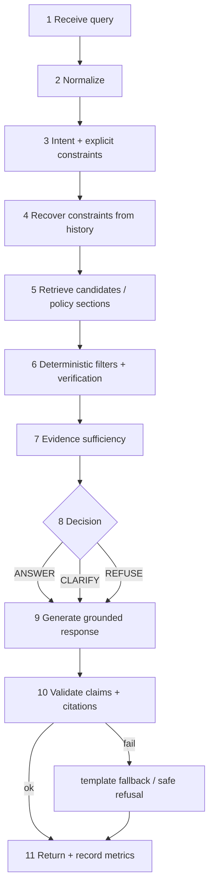

# RAG_PIPELINE.md — Retrieval, query pipeline, ambiguity, multi-turn state

> Design only; nothing implemented or tuned. All thresholds named here (`tau_cov`, `tau_sem`, `rrf_k`, …) live in `config/decision_thresholds.yaml` and are tuned **only on the team's dev set** (see `EVALUATION_PLAN.md`). Model-dependent behaviour (embedding quality, code-mix handling) is unmeasured.

## 1. Retrieval approaches compared

| Approach | Strengths | Weaknesses | Role here |
|---|---|---|---|
| **Exact structured filtering** (SQL/Python on price, stock, category, rating, verified attributes) | Exact, deterministic, explainable, cheap | Needs parsed constraints; cannot interpret free text | **Hard gate.** Defines the eligible set. Only source of price/stock/rating truth. |
| **Lexical (BM25 / FTS5)** | Exact tokens: model codes, brand words, IDs; stable; no model needed | Misses synonyms and code-mixed words | Candidate recall and ranking; **decides existence of named entities** |
| **Semantic vectors** | Synonyms, paraphrase, some code-mixed phrasing (as far as the model supports; unmeasured) | Blurs exact tokens; cannot prove a fact; may match "similar but wrong" items | Candidate recall and ranking only. Never confirms an attribute, price, stock, or existence. |
| **Hybrid** | Combines recall of both | More moving parts | **Recommended:** pre-filter (exact) → rank eligible set with BM25 + cosine → RRF → verify |

**Recommended combination:** *exact pre-filter → (BM25 ∥ cosine) restricted to the eligible set → Reciprocal Rank Fusion → attribute verification → ambiguity analysis.* At 5,000 products, restricted search is brute force and fast, so there is no truncation risk from a global top-k.

Rule ADR-04: **semantic score can order and recall; it can never establish an exact product attribute, price, stock status or the existence of a named product.**

## 2. Pipeline overview (11 steps)



Order note: filtering happens **before** ranking inside step 5/6 (`filters.eligible_ids` → `hybrid.search`); the document keeps "retrieve, then filter" numbering from the brief for readability. Step 6 additionally verifies attributes and re-checks constraints.

## 3. Domain types (shared contracts)

```python
class Intent(str, Enum):
    PRODUCT_FACT = "PRODUCT_FACT"        # price/stock/rating/category/attribute of a named product or ID
    EXISTENCE = "EXISTENCE"              # "do you sell X"
    SEARCH = "SEARCH"                    # browse/filter
    COMPARE = "COMPARE"                  # Tier 3
    POLICY = "POLICY"                    # returns/shipping/warranty (store policy)
    PRODUCT_WARRANTY = "PRODUCT_WARRANTY"
    GREETING_HELP = "GREETING_HELP"
    RESET = "RESET"
    OUT_OF_SCOPE = "OUT_OF_SCOPE"        # includes unsupported actions (order, pay, track)
    UNKNOWN = "UNKNOWN"

class RequestedField(str, Enum): PRICE; STOCK; RATING; CATEGORY; DESCRIPTION; ATTRIBUTE; TITLE

@dataclass(frozen=True)
class ParsedQuery:
    original: str
    normalized: str
    trace: list[TraceItem]                # every normalization/codemix/spellfix change
    intent: Intent
    requested_fields: list[RequestedField]
    attribute_key: str | None             # when asking for a specific attribute
    product_ids: list[str]                # explicit IDs in the text (regex from config)
    entity_text: str | None               # noun phrase naming a product ("blue running shoe")
    references_focus: bool                # "it/this/that", set by reference_resolver
    ordinal_ref: int | None               # "second one" (Tier 3)
    policy_topic: str | None
    constraint_ops: list[ConstraintOp]    # explicit constraints found in this turn
    text_terms: list[str]
    confidence: float

@dataclass(frozen=True)
class PriceBound: amount_minor: int; inclusive: bool
@dataclass(frozen=True)
class AttrConstraint: key: str | None; value: str     # key None = any attribute / text
@dataclass(frozen=True)
class SortSpec: field: Literal["price","rating"]; direction: Literal["asc","desc"]

@dataclass(frozen=True)
class ConstraintSet:
    categories: frozenset[str]            # canonical category_norm values, OR semantics
    price_min: PriceBound | None
    price_max: PriceBound | None
    stock: StockStatus | None             # IN_STOCK | OUT_OF_STOCK
    rating_min: float | None
    attributes: tuple[AttrConstraint, ...]   # AND semantics
    text_terms: tuple[str, ...]           # soft topical terms (rank only unless lexical-verified)
    sort: SortSpec | None

@dataclass(frozen=True)
class ConstraintOp: op: OpKind; key: str; value: Any; origin: Literal["USER_TEXT","UI_ACTION","CLARIFICATION"]

@dataclass(frozen=True)
class SearchSpec: constraints: ConstraintSet; query_text: str; entity_text: str | None; top_k: int; intent: Intent

@dataclass(frozen=True)
class Candidate:
    product_id: str
    lexical_rank: int | None; lexical_score: float | None
    semantic_rank: int | None; semantic_score: float | None
    fused_score: float
    entity_coverage: float                # fraction of entity tokens found in title+attribute values
    match_location: Literal["TITLE_OR_ATTR","DESCRIPTION_ONLY","SEMANTIC_ONLY"]
    attr_matches: tuple[AttrMatch, ...]
    match_basis: Literal["EXACT_CONSTRAINTS","SEMANTIC_RELATED"]

@dataclass(frozen=True)
class SearchResult:
    search_id: str                        # "s_<turn>"
    candidates: list[Candidate]           # ordered, post-verification, truncated to top_k
    eligible_count: int                   # after exact filters
    verified_count: int                   # after attribute/text verification
    excluded_unknown_stock: int
    relaxations: list[Relaxation]         # only when verified_count == 0
    lexical_available: bool; semantic_available: bool

@dataclass(frozen=True)
class DecisionPlan:
    decision: Decision
    intent: Intent
    reason: RefusalReason | ClarifyReason | None
    claim_specs: list[ClaimSpec]          # typed facts to be asserted (values read from DB)
    clarification: ClarificationSpec | None
    refusal: RefusalSpec | None
    product_ids_for_cards: list[str]
    nonfactual_kind: str | None           # "GREETING","HELP","RESET_ACK", else None
    constraints_after: ConstraintSet
    search: SearchResult | None
```

## 4. Step contracts

Each step lists **input → output → failure handling**. The orchestrator wraps every step in a timer and a try/except; unexpected exceptions become `INTERNAL_ERROR` (HTTP 500) only for steps 1–2 failures that indicate a bug; otherwise they follow the stated fallback.

### Step 1 — Receive
- Input: `ChatRequest`. Output: sanitized `message`, `ConversationState` (create/load).
- Failure: validation errors → 4xx (`API_SPEC.md` §4.8). Unknown `session_id` format → 422. Expired session → new state, warning none.

### Step 2 — Normalize (`nlp/normalizer.py`, `codemix.py`, `spellfix.py`)
- Input: raw message. Output: `NormalizedText(original, text, trace)`.
- Operations in order, each recorded in `trace`:
  1. NFKC, collapse whitespace, strip control chars.
  2. Protect tokens: product IDs (config regex), numbers, currency amounts are masked and restored (never altered).
  3. Currency/number canonicalisation: `₹2,000`, `Rs 2000`, `2000 rs`, `inr 2k`, `2k`, `1.5k`, `1 lakh` → numeric amounts (decimal), with the original span kept in the trace.
  4. Code-mix lexicon (`codemix_terms.yaml`): whole-token replacement only. Lexicon content is team-authored from the actual test-language needs (UNK-15); the file ships with a handful of **illustrative seeds that must be reviewed by a speaker**. Unknown tokens remain untouched (a small embedding model may or may not handle them; unmeasured).
  5. Spell-fix: only tokens **not in** the catalogue vocabulary, with a unique best candidate at ratio ≥ `spell_ratio` (default 0.85), token length ≥5, never touching IDs/numbers. Ambiguous corrections are not applied.
- Meaning preservation test: normalization must be idempotent and must never change a number or ID (`T-NLP-*`).
- Failure: any exception → continue with sanitized original text and a trace entry `NORMALIZE_SKIPPED`.

### Step 3 — Intent and explicit constraints (`intent.py`, `constraint_extractor.py`, `price_parser.py`)
- Input: `NormalizedText`, `CatalogueVocab`, cues. Output: `ParsedQuery`.
- **Intent rules** (ordered, first match wins; cue lists in `intent_cues.yaml`):
  1. `RESET`: "start over", "new search", "reset", "clear filters", and equivalents.
  2. `OUT_OF_SCOPE`: matches `out_of_scope.yaml` (weather, news, jokes, coding, medical/legal advice, order/payment/tracking actions).
  3. `POLICY`: policy cue words (return, refund, exchange, shipping, delivery, warranty, guarantee, cancel…) **and** no product reference → `POLICY` with `policy_topic` guessed from keywords (or `None`). If a product reference/pronoun/ID is present and the cue is warranty → `PRODUCT_WARRANTY`.
  4. `PRODUCT_FACT`: question cues for price/cost/stock/rating/category/attribute **and** (explicit ID or entity text or focus pronoun).
  5. `EXISTENCE`: "do you sell/have/stock", "is there", "available in the catalogue" + entity text.
  6. `SEARCH`: show/find/list/suggest/need/looking for + any constraint or noun phrase; also bare constraint turns ("under 2000", "only in stock") when state has constraints.
  7. `GREETING_HELP`.
  8. `UNKNOWN` → treated as `SEARCH` if it contains ≥1 content term, else CLARIFY `UNDER_SPECIFIED_QUERY`.
- **Price phrases** (`price_parser.py`), inclusive/exclusive semantics are explicit and configurable (UNK-14; defaults shown):

| Phrase family | Op | Default semantics |
|---|---|---|
| under, below, less than, cheaper than, `<` | `SET price_max` | exclusive (`<`) |
| up to, upto, within, max, at most, not more than, budget of | `SET price_max` | inclusive (`<=`) |
| over, above, more than, `>` | `SET price_min` | exclusive (`>`) |
| at least, min, from, starting at | `SET price_min` | inclusive (`>=`) |
| between A and B, A–B, A to B | `SET price_min` + `SET price_max` | inclusive both |
| around/about X | not a constraint | ignored with trace note; if the only constraint → CLARIFY `UNDER_SPECIFIED_QUERY` |

- **Stock**: "in stock", "available", "only in stock", "stock mein" (code-mix) → `SET stock IN_STOCK`; "out of stock", "sold out" → `SET stock OUT_OF_STOCK`.
- **Rating**: "4 stars and above", "rated 4+", "at least 4.5" → `SET rating_min`; "top rated/best rated" → `SET sort rating desc` (items without rating excluded and counted).
- **Sort**: "cheapest", "lowest price" → `price asc`; "most expensive" → `price desc`.
- **Category**: match normalized query n-grams against `CatalogueVocab.categories` (exact), `category_aliases.yaml` (team-curated, e.g. "clothes" → [categories]), then a lexical stem match. A category is a **hard** constraint only when resolved by one of these. If not resolved, the words become `text_terms`.
- **Attributes**: tokens that exist in `attr_values_by_key` become `AttrConstraint(key, value)`; if a value occurs under several keys → `key=None`. Numeric attribute phrases ("8 GB", "5 kg") parse to `value_num+unit` when the unit table lists the unit.
- **Product IDs**: config regex over the raw (pre-normalization) text; case-sensitive then case-insensitive fallback; the match is accepted only if the ID exists, else it is still recorded (to produce an explicit not-found refusal).
- **Entity text**: for `PRODUCT_FACT`/`EXISTENCE`, the noun phrase left after removing cue words, constraints and stopwords.
- Failure: extraction exceptions → `UNKNOWN` intent with no ops (→ CLARIFY). Tier 3 may call the LLM here; its output is validated against vocab, otherwise discarded.

### Step 4 — Recover constraints from history (`conversation/*`)
- Input: `ParsedQuery`, `ConversationState`, `ChatRequest.constraint_ops/resolution/client_context`. Output: `ConstraintSet` (after), `MergeResult.conflicts`, `focus`.
- Details in §7 (multi-turn).
- Failure: merge conflicts are not errors; they produce CLARIFY `CONTRADICTORY_CONSTRAINTS`.

### Step 5 — Retrieve (`retrieval/hybrid.py`, `policy_retriever.py`)
For product intents:
1. `eligible = filters.eligible_ids(constraints)` — SQL on `category_norm`/`product_categories`, `price_minor`, `stock_status`, `rating`.
2. Query text for ranking = `text_terms + entity_text + attribute values` (stop words removed).
3. `lexical.search(query, allowed=eligible, k=pool)` (FTS5 BM25 with column weights) and `semantic.search(query, allowed=eligible, k=pool)` (if embedder available). Default `pool = 100`.
4. `fusion.rrf([lex_ids, sem_ids], k=60)` → fused order. Ties: higher lexical score, then lower price, then `product_id` ascending (deterministic).
5. If `product_ids` were explicit, direct repo lookup **bypasses** ranking (constraints are not applied to an explicit ID lookup).
- Failure: embedder error → `semantic_available=False`, continue lexical-only with warning `SEMANTIC_UNAVAILABLE`. FTS error → Python BM25. Empty eligible set → short-circuit to step 6 with `eligible_count=0`.

For policy intents: `PolicyRetriever.search(question, topic)` — BM25 over `policy_fts` (+ cosine over section embeddings if built; optional), restricted to `topic` sections when topic is known; returns top 3 sections with a **coverage test**: the question's content terms (stopwords removed, minus generic words like "policy", "your", "do", "you") must be covered ≥ `policy_tau_cov` by the section text (stem-matched), and a topic keyword hit must exist. `established = coverage_ok`.

### Step 6 — Deterministic filters and verification (`attribute_verifier.py`, `ambiguity.py`, `relaxation.py`)
- For each fused candidate in order: verify all `AttrConstraint`s (structured preferred, description text with negation guard, title as text evidence). Candidates failing verification are dropped. Continue until `top_k` verified candidates are found; keep counting `verified_count` over the whole eligible/fused set (bounded by the pool; if the pool is exhausted before verification completes, `verified_count` is a lower bound and the manifest records `verified_count_is_lower_bound=true`).
- Constraint re-check: price/stock/rating are re-read from DB for each returned candidate (a second independent check; also enforced later by V-10).
- `match_basis`: `EXACT_CONSTRAINTS` if every constraint passed and (no `text_terms` or all text terms lexically present in title/description/attributes); `SEMANTIC_RELATED` if hard constraints passed but a topical text term had no lexical hit (shown with a "closest by meaning" note; no claim asserts it satisfies the term).
- **Missing-match detection**: `verified_count == 0`. Then `relaxation.analyze` drops each constraint independently (price, stock, rating, each attribute, category) and records the result counts — used only to craft cited suggestions ("No cotton shirts under ₹2,000 in stock; 3 match without the stock requirement"). Suggestions are structured `ConstraintOp`s and carry the search manifest as evidence.
- **Entity resolution / ambiguity** (`resolve_entity`), for `PRODUCT_FACT`/`EXISTENCE` without explicit ID:
  1. `entity_coverage(c)` = fraction of entity tokens (stemmed, stopwords removed) present in `title ∪ attribute values` of `c`. Description-only presence is recorded as `DESCRIPTION_ONLY`.
  2. `best = max coverage`. If `best < tau_cov` (default 0.67) → `NONE`.
  3. `C = {c : coverage(c) == best}`. If `|C| == 1` → `RESOLVED`. If `|C| ≥ 2` → `AMBIGUOUS` **regardless of semantic scores** (semantic similarity cannot break an exactness tie; it may only order the options).
  4. Options = up to `clarify_max_options` of `C` ordered by fused score, then `product_id`.
  5. Optional enhancement (off by default): if all candidates in `C` have an identical requested field value, answer for all instead of clarifying.
- **Broad-query guard**: a `SEARCH` with no hard constraint **and** no text term with a lexical hit → CLARIFY `UNDER_SPECIFIED_QUERY`.

### Step 7 — Evidence sufficiency (`decision/rules.py`)
Determines, for the requested intent, whether every requested fact exists as a non-null DB value or policy quote. Outputs per-field availability (`AVAILABLE` / `MISSING`). Existence claims require lexical `TITLE_OR_ATTR` evidence; absence claims require a zero-result `SearchManifest`.

### Step 8 — Decision (`decision/engine.py`)
Applies rules D-01…D-17 from `GROUNDING_AND_REFUSAL.md` §3 in the precedence order given there. Output `DecisionPlan`.
- Failure: an uncaught rule exception → REFUSE `INSUFFICIENT_EVIDENCE` and a logged defect.

### Step 9 — Generate (`generation/*`)
1. `evidence_builder.build(plan)` creates `Evidence` objects from DB/policy rows and registers their IDs.
2. Mode selection: `TEMPLATE` if `generation_mode=TEMPLATE` or LLM disabled/unhealthy; else `LLM` (Tier 2).
3. `TemplateGenerator`: renders each `ClaimSpec` into a sentence (deterministic).
4. `LlmGenerator` (Tier 2): sends the ClaimSpecs as structured facts (no raw descriptions beyond short delimited excerpts) and requires JSON `[{"claim_id": "...", "sentence": "..."}]`. It cannot add or remove claims.
5. `citation.render_answer_text` assembles `answer_text`.
- Failure: LLM timeout/unavailable/unparseable output → immediate `TemplateGenerator` fallback; `generation.fallback_reason` set.

### Step 10 — Validate (`validation/validator.py`)
Runs V-01…V-12 (`GROUNDING_AND_REFUSAL.md` §5) against a **fresh DB read**. If violations:
1. LLM mode → retry once in `TEMPLATE_FALLBACK` mode, revalidate.
2. Template mode failing validation → safe REFUSE `INTERNAL_VALIDATION_FAILURE` with fixed fact-free text; defect logged with the violation list; `metrics.validator_trips += 1`.

### Step 11 — Return and record
Return `ChatResponse`; update `ConversationState` (constraints, focus, last results, pending clarification); write `metrics` (timings per stage, token usage with `token_source`, fallback info). State is saved **after** validation; a failed turn does not corrupt constraints (constraints_after are saved only when the turn completes with ANSWER/CLARIFY/REFUSE-by-rule; for `INTERNAL_VALIDATION_FAILURE` the prior constraints are kept).

## 5. Ranking summary

1. Eligible set from exact filters.
2. BM25 rank and cosine rank within the eligible set.
3. RRF (`1/(k+rank)` sum, `k=60`).
4. Tie-breakers: lexical score ↓, price ↑ (NULL price last), `product_id` ↑.
5. If the shopper asked for `sort`: after verification, results are ordered by the requested field (`NULL`s last and excluded from "highest rated" with a manifest note), with the fused rank as a secondary key.

## 6. Policy retrieval summary

- Sections carry stable IDs and verbatim bodies. Retrieval returns sections, never rewritten text.
- Every policy claim is tied to exactly the sections it quotes (`pol:<section_id>`).
- No answer unless the coverage test passes (D-09). "Nothing in the supplied policy document establishes this" is a refusal, not a guess.
- Warranty: store policy ≠ product warranty. Product-specific warranty claims need product evidence (V-09); policy text is presented as general policy.

## 7. Multi-turn conversation design

### 7.1 State schema

```python
@dataclass
class ConversationState:
    session_id: str
    constraints: ConstraintSet            # active search constraints
    focus_product_id: str | None          # set when the last answer concerned exactly one product, or UI sets it
    last_result_ids: list[str]            # IDs shown in the last SEARCH answer (for ordinals, Tier 3)
    pending: PendingClarification | None  # {clarification_id, reason, options with payloads, parsed_query snapshot}
    turn_no: int
    updated_at: float                     # monotonic/wall time for TTL
    history_summary: list[TurnRecord]     # last N turns: intent, decision, constraint_ops applied (no raw text unless logging enabled)
```

Storage: in-memory `SessionStore`, LRU-bounded (`max_sessions=1000`), TTL `session_ttl_s=1800`. Raw message text is not stored in state.

### 7.2 Merge rules (`conversation/merger.py`)

| Key | Same-key new value | Different key | Explicit removal |
|---|---|---|---|
| `price_min`, `price_max`, `stock`, `rating_min`, `sort` | **replace** the old value | accumulate | "remove price limit", "any price", `REMOVE price_*` clears min and max |
| `categories` | replace unless the turn carries an additive cue ("also", "and", "as well", "plus"), then union | accumulate | "any category" / `REMOVE category` |
| `attributes` | **add** (AND) unless the same key with a different value in the same turn replaces ("blue" → "red": replace if cue "instead/actually/change to") | accumulate | "not cotton anymore", "remove cotton", `REMOVE attribute` with value |
| `text_terms` | replace on topic switch, else append | | `REMOVE text_term` |
| all | | | `RESET`: clears everything |

Example trace (the stretch goal):

| Turn | User | Ops | Constraints after |
|---|---|---|---|
| 1 | "Show cotton clothes." | `ADD attribute cotton`, `ADD category <clothing categories via alias>` | cotton ∧ clothing |
| 2 | "Under ₹2,000." | `SET price_max <200000 exclusive` | cotton ∧ clothing ∧ price<₹2,000 |
| 3 | "Only in stock." | `SET stock IN_STOCK` | cotton ∧ clothing ∧ price<₹2,000 ∧ in stock |

Turn 3's `SearchManifest` must list all three constraints (acceptance test T-MT-01).

### 7.3 Contradictions

After merging, `conflicts` are detected:
- `price_min >= price_max` (taking inclusivity into account) → conflict `PRICE_RANGE_EMPTY`.
- `stock=IN_STOCK` and a new `OUT_OF_STOCK` → handled as **replace** (same key), not a conflict.
- Two incompatible attribute values for a single-valued key in one turn ("red and blue shirt" when `color` is single-valued) → allowed as OR? **No**: treated as an AND of two values; if zero results, relaxation reports it. Only genuine logical impossibilities (price range) are conflicts.
- A conflict yields CLARIFY `CONTRADICTORY_CONSTRAINTS` with two options, each a list of `constraint_ops` ("Keep ‘over ₹5,000’ and drop ‘under ₹2,000’" / "Keep ‘under ₹2,000’ and drop ‘over ₹5,000’"). State is **not** mutated until the user picks.

### 7.4 Removing or modifying constraints
- By text: "remove the price limit", "any colour", "forget cotton", "start over".
- By UI: chips send `constraint_ops` with `REMOVE`; suggestions send `SET`/`ADD`.
- Modification = replace on the same key (e.g. "under ₹1,500" replaces "under ₹2,000").

### 7.5 When context must **not** be carried forward
| Situation | Behaviour |
|---|---|
| `RESET` intent / `RESET` op / session TTL expiry / `/api/session/reset` | Clear everything |
| `POLICY` intent turns | Do not read or change search constraints |
| `PRODUCT_FACT`/`PRODUCT_WARRANTY` with an explicit product ID | Ignore search constraints for the lookup (an explicit ID is answered regardless of the active price filter) and do not modify them |
| Topic switch: a new category that differs from the active categories **without** an additive cue | Keep global constraints (price, stock, rating) but drop `attributes`, `text_terms`, `sort`; answer states "Still applying: …"; chips display what remains, so the shopper can remove them |
| A new explicit product ID/title lookup | Sets `focus_product_id`; does not clear constraints |
| Pending clarification ignored (user types an unrelated message) | Pending is dropped; the new message is processed on its own |
| Contradictory constraints awaiting resolution | State stays at the prior consistent value |

### 7.6 References
- `it/this/that/ye` + `focus_product_id` set → resolved. No focus → if `last_result_ids` non-empty offer them as options, else open question (CLARIFY `UNRESOLVED_REFERENCE`).
- UI "ask about this" sets `client_context.focus_product_id` (validated against DB).
- A pending `AMBIGUOUS_PRODUCT` clarification can be answered by `resolution` (preferred) or by typed text that uniquely matches exactly one option label by lexical coverage; otherwise the clarification repeats.
- Ordinals ("the second one") are Tier 3.

## 8. Performance notes (targets, not measurements)

Brute-force cosine over ~5,000 × `dim` float32 and FTS5 over 5,000 rows are expected to be small relative to model inference, but **no timing has been measured**. Targets for Day 6 verification: lexical+filters and decision in the same order of magnitude as a database query; record real numbers with `scripts/benchmark.py`.

## 9. Acceptance criteria

| ID | Criterion |
|---|---|
| RAG-AC-01 | Eligible set is computed before ranking; tests prove a valid match ranked 101st lexically is still returned when constraints narrow the set |
| RAG-AC-02 | Semantic-only candidates are never reported as satisfying an attribute/term claim; they carry `match_basis=SEMANTIC_RELATED` |
| RAG-AC-03 | Entity ties never resolve by semantic score; they produce CLARIFY |
| RAG-AC-04 | Zero-result searches yield a SearchManifest with `verified_count=0` and relaxation counts |
| RAG-AC-05 | All price/stock/rating values in results equal DB values (property test) |
| RAG-AC-06 | Normalization is idempotent and never changes numbers or product IDs |
| RAG-AC-07 | Stretch-goal three-turn scenario preserves all three constraints |
| RAG-AC-08 | With the embedder removed, search and the full test suite still run (lexical-only) |
| RAG-AC-09 | Policy retrieval returns section IDs that exist, with verbatim bodies |
