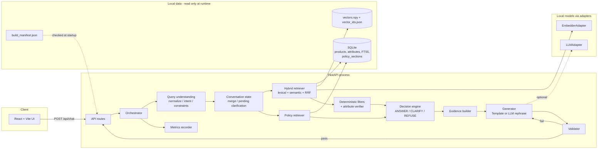
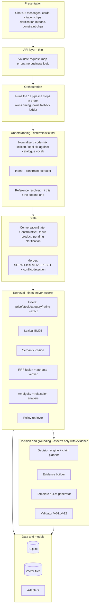
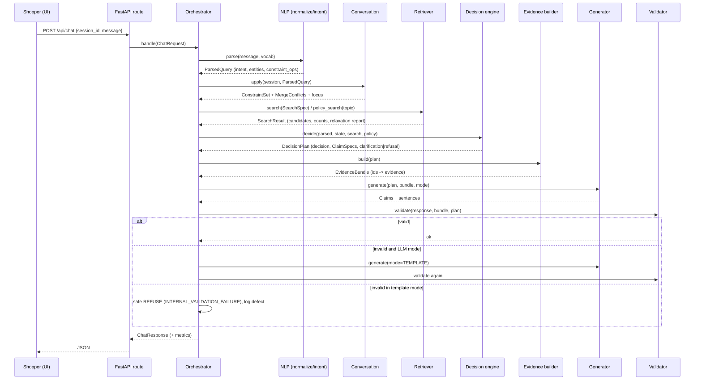
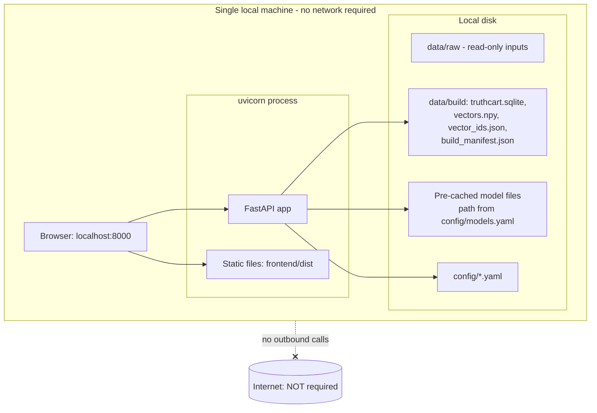

# architecture.md — TruthCart AI

> Design document. Nothing here is implemented or verified. Items tagged **UNK-xx** are unknowns that must be resolved on Day 1 (register in §10). Items tagged **Tier n** refer to the MVP tiers in `README.md`.

## 1. Goals and non-goals

**Goals**
- Answer shopper questions using only the supplied catalogue (5,000 products) and policy document.
- Eliminate hallucinated prices, specs and policies; cite every factual claim.
- Choose between ANSWER, CLARIFY and REFUSE by explicit, testable rules.
- Run fully offline on a laptop with no paid services.
- Be implementable by four people in seven days.

**Non-goals**
- Claims about the wider retailer's inventory, orders, payments, live stock, or anything outside the two source files.
- Free-form product advice or subjective judgement ("best for me") beyond sorting on catalogue fields.
- Authentication, user accounts, persistence of conversations across server restarts.

## 2. Core principle: facts come from code, words come from templates

```
Facts      = SQLite rows + policy sections (immutable, validated at ingestion)
Claims     = typed records created by code, each pointing at evidence IDs
Sentences  = rendered from claims by Templates (Tier 0) or rephrased by an LLM (Tier 2)
Validator  = deterministic gate; failure → template fallback → safe refusal
```

Consequences:
- The LLM cannot add, remove or alter claims. It may only rephrase the sentence for a claim whose facts are supplied to it, and the validator checks the result.
- If the model is absent, slow, or malformed, the system still works (template path).

## 3. Technology decisions

| Area | Decision | Rationale / change from proposal |
|---|---|---|
| Backend | Python (version per UNK-12, assume ≥3.10) + FastAPI + pydantic v2 | As proposed. Pydantic gives schema validation for every internal and external contract. |
| Product store | SQLite (stdlib `sqlite3`) | As proposed. Single file, exact filters, transactions. |
| Lexical search | SQLite **FTS5** (BM25). Fallback: pure-Python BM25 in `retrieval/lexical.py` if FTS5 is unavailable (UNK-12) | Exact tokens (model codes, IDs, brands) are where embeddings are weakest. |
| Vector search | **NumPy matrix + cosine** behind a `VectorIndex` interface | **Change from proposed ChromaDB.** 5,000 × ~384 float32 ≈ 8 MB; brute force is milliseconds. Chroma adds a heavy dependency, offline/version risk and no benefit at this scale. FAISS/Chroma remain Tier 3 drop-ins. Dimension unknown until UNK-08. |
| Fusion | Reciprocal Rank Fusion (k=60, configurable) | Parameter-light, no score calibration between BM25 and cosine. |
| Exact filtering | Pre-filter in SQL/Python **before** ranking | Prevents top-k truncation from hiding valid matches. |
| Models | `EmbedderAdapter` and `LLMAdapter` interfaces + `MockEmbedder`/`MockLLM`; concrete runtime adapter chosen after UNK-08/09 | Model files, names and runtime are unknown; nothing is assumed. |
| Frontend | React 18 + TypeScript + Vite; `useReducer` + Context; no router, no Redux, no UI kit | Single screen. Fewer dependencies = fewer offline surprises. |
| Testing | pytest, FastAPI `TestClient`, optional Vitest + React Testing Library | As proposed. |
| Deployment | One local process: uvicorn serving API and the built frontend (`frontend/dist`) | Offline demo needs no Node at runtime. |

Explicitly **not** used: LangChain/LlamaIndex, cloud DBs, auth services, pandas (stdlib `csv`/`json` suffice), Redis, Docker (optional only).

## 4. Diagrams

### 4.1 Architecture diagram



### 4.2 Component responsibility diagram



### 4.3 Request-to-response data flow



### 4.4 Deployment diagram (offline)



Build-time vs run-time separation: `scripts/build_index.py` reads `data/raw` and writes `data/build`. The server opens `data/build` read-only. Indexing time is never included in query latency.

## 5. Component catalogue (responsibilities and dependencies)

| Component | Responsibility | Depends on |
|---|---|---|
| `api/*` | HTTP surface, request validation, error envelope | `schemas`, `orchestrator` |
| `orchestrator` | Executes the pipeline, owns fallbacks and timing | all pipeline modules |
| `ingest/*` | Build-time: read, validate, normalize, quarantine, index | `config`, `store.db` |
| `store/*` | SQLite access, vector index, repositories | `sqlite3`, `numpy` |
| `nlp/*` | Normalize queries, classify intent, extract constraints | `store` (vocab), `config/lexicons` |
| `conversation/*` | Session state, merge rules, pending clarifications | `domain` |
| `retrieval/*` | Candidate recall, exact filtering, attribute verification, ambiguity, relaxation, policy retrieval | `store`, `models.EmbedderAdapter` |
| `decision/*` | Apply decision rules, plan claims | `retrieval`, `conversation` |
| `generation/*` | Evidence objects, template rendering, optional LLM rephrase, citation markers, product cards | `store`, `models.LLMAdapter` |
| `validation/*` | Enforce V-rules; independent scanners | `store` (re-reads DB) |
| `models/*` | Adapter interfaces, mocks, runtime-specific adapters | local model files (UNK-08/09) |
| `metrics/*` | Per-stage timers, token accounting, memory | stdlib (+ optional `psutil`) |
| `eval/*` | Test-set adapter, official bridge, auditor, scoring, reports | `orchestrator` (in-process) |

Dependency rules (enforced by an import-linter-style test, `test_architecture_imports.py`):
- `validation` and `eval/auditor.py` must **not** import `generation` or `decision` (independence from the code they check).
- `api` must not import `retrieval`, `store`, or `models` directly.
- No module under `app/` may import from `eval/` or read `data/raw/test_questions*` (anti-hardcoding).

## 6. Degradation ladder

| Level | Condition | Behaviour |
|---|---|---|
| L0 | All components healthy | Tier 1/2 full path |
| L1 | LLM missing, timed out, or output invalid | Template generator; `generation.mode = TEMPLATE_FALLBACK` or `TEMPLATE` |
| L2 | Embedder missing or failing | Lexical-only retrieval; `warnings += ["SEMANTIC_UNAVAILABLE"]`; `/api/ready` reports `semantic: false` |
| L3 | FTS5 unavailable | Pure-Python BM25 over in-memory index |
| L4 | `build_manifest.json` does not match DB/vectors, or DB missing | `503 INDEX_NOT_READY`; chat refuses to start answering |
| L5 | Template output fails validation | Safe REFUSE `INTERNAL_VALIDATION_FAILURE` (contains no facts) and a defect log entry |

Chat must never return HTTP 5xx because of model failure; only L4 (or an unhandled bug) yields 5xx.

## 7. Cross-cutting design

- **Configuration**: YAML under `config/`, loaded once into frozen pydantic `Settings`. No behaviour-changing constants in code. Thresholds live in `config/decision_thresholds.yaml` and are tuned only on the dev set.
- **Determinism**: temperature 0 for any LLM call; stable sort keys (`score DESC, price ASC, product_id ASC`); fixed RRF constants; build manifest hashes; no wall-clock or random inputs in decisions.
- **Errors**: one error envelope (`API_SPEC.md` §3). Internal failures map to a stable `code`.
- **Observability**: per-request `Metrics` object (stage timings, token counts with `token_source`, validator trips, fallbacks) returned in the response and appended to `data/logs/requests.jsonl` (see §8 for what is logged).

## 8. Security and data handling

| Concern | Design |
|---|---|
| Input validation | `message` 1–500 chars after trim; control characters (except `\n`, `\t`) stripped; Unicode NFKC; `session_id` must match `^[A-Za-z0-9_-]{8,64}$`; unknown JSON fields rejected (`extra="forbid"`). |
| Safe file ingestion | Inputs read only from `data/raw` by `ingest/source_reader.py`: size cap (configurable, default 50 MB catalogue, 2 MB policy), UTF-8 decode with explicit error handling, streaming CSV/JSON parse, **no `eval`, no `pickle`, no `yaml.load` (use `safe_load`), `numpy.load(allow_pickle=False)`**. Paths are resolved and checked to be inside the project root. |
| SQL safety | Parameterized queries only. FTS5 `MATCH` strings are built by quoting each token (`"token"`) after stripping FTS operators (`AND OR NOT NEAR * : ^ ( ) "`). |
| API errors | Stack traces never returned. Unknown exceptions → `500 INTERNAL_ERROR` with a `request_id`. |
| CORS | Allow only `http://localhost:5173` and `http://localhost:8000` by default (configurable). |
| Secrets | None required for core. Optional integrations (Tier 3) read keys from environment variables named in `config/app.yaml`; `.env` is git-ignored; secrets are never logged and never sent to the frontend. |
| Prompt injection (product/policy text is untrusted) | (1) The decision logic runs in code, not in the model. (2) `ingest/sanitizer.py` flags records matching instruction-like patterns (`suspicious_text=1`). (3) The Tier 2 prompt contains **structured facts**, not raw descriptions; the few description excerpts that are allowed are ≤200 chars, delimited, and omitted entirely for flagged records. (4) The validator forbids any sentence not derived from a ClaimSpec, so injected instructions cannot add content. (5) Flagged products remain searchable and displayed through the template path, which quotes text verbatim as data. |
| Logging | Default: log a SHA-256 prefix of the message, its length, intent, decision, timings. Raw message text is logged only when `logging.log_message_text=true` (default `false`; enabled for evaluation runs where the questions are not personal). No IP addresses, no user agents, no session-to-person linkage. Logs are local files. |
| Reproducibility | Pinned dependencies (`requirements.txt` with exact versions), `build_manifest.json` with hashes of inputs/config/vectors/model IDs, deterministic build, fixed seeds where any randomness exists. |
| Offline | No code path may make outbound network calls in core operation. `scripts/check_offline.py` and `tests/e2e/test_offline.py` run the app with sockets blocked. Model loaders set offline environment variables as required by the chosen runtime (UNK-08/09). |

## 9. Requirement traceability

| Hackathon acceptance criterion | Where it is enforced | Verified by (see TESTING_PLAN.md) |
|---|---|---|
| All factual claims traceable to catalogue/policy | Claims carry evidence IDs; validator V-01–V-05 | T-VAL-*, T-FACT-* |
| Prices/stock never from model knowledge | Values come from `ClaimSpec` built from SQLite rows; validator V-03/V-04/V-05 re-checks | T-PRICE-*, T-FACT-01 |
| Ambiguity → clarification | `retrieval/ambiguity.py`, decision rules D-05/D-06 | T-AMB-* |
| Unsupported → refusal/qualified statement | Decision rules D-07…D-12, ABSENCE claims with search manifest | T-REF-*, T-POL-* |
| Citations validated before return | Orchestrator never returns an unvalidated response | T-VAL-*, T-E2E-* |
| Multi-turn constraints preserved | `conversation/merger.py` | T-MT-* |
| No paid external services | Local adapters only; offline test | T-OFF-* |
| Official evaluator pluggable | `eval/official_bridge.py` + `Orchestrator.handle()` unchanged | T-EVAL-* |
| 7-day MVP | Tiers + fallback MVP | `IMPLEMENTATION_PLAN.md` |

## 10. Unknowns register (all must be closed on Day 1)

| ID | Unknown | Why it matters | Resolved by |
|---|---|---|---|
| UNK-01 | Catalogue file format and field names | Mapping config, loader | `scripts/inspect_inputs.py` |
| UNK-02 | Price representation (numeric/string), currency, decimals | Exact filtering and display | inspect + sample |
| UNK-03 | Stock representation and distinct values | `stock_value_map` | inspect distinct values |
| UNK-04 | Attribute representation (dict, list of pairs, free text) | Attribute table, verifier | inspect |
| UNK-05 | Product ID format and uniqueness | `product_id_regex`, dedupe | inspect |
| UNK-06 | Rating scale, rating-count field presence | Validation range | inspect |
| UNK-07 | Policy document structure (headings, numbering) | Parser strategy | read file |
| UNK-08 | Embedding model: name, dimension, format, required prefixes, runtime, CPU speed | Adapter, index build | `scripts/smoke_models.py` |
| UNK-09 | Instruction model: runtime, context length, chat template, JSON/grammar support, token counts exposed?, CPU speed | Tier 2 feasibility | `scripts/smoke_models.py` |
| UNK-10 | `evaluate.py` contract: how it invokes the system, input/output format, scoring | Official bridge | read file, record in `docs/OFFICIAL_EVALUATOR_NOTES.md` |
| UNK-11 | Test question file format, labels visible/hidden, multi-turn items? | Test-set adapter | read file |
| UNK-12 | Hardware, OS, Python version, SQLite FTS5 availability | Latency budget, lexical fallback | `scripts/inspect_inputs.py --env` |
| UNK-13 | Is use of the supplied instruction model mandatory? Are `pip install`s allowed at demo time? | Tier 2 status, vendoring | organizer rules |
| UNK-14 | Boundary semantics ("under ₹2,000" excludes ₹2,000?) and mapping of our decisions/reasons to official labels | Filter semantics, bridge | evaluator examples; default is strict `<` |
| UNK-15 | Languages in code-mixed queries | Lexicon content | test questions (read-only inspection for language, not answers) |
| UNK-16 | Is the UI graded? | Frontend time budget | organizer rules |

## 11. Architecture decision log (initial)

| ID | Decision | Alternative rejected |
|---|---|---|
| ADR-01 | Facts via code; text via templates; LLM only rephrases claims | LLM answers from retrieved context (hallucination risk, unverifiable) |
| ADR-02 | Pre-filter then rank | Retrieve top-k then filter (drops valid matches) |
| ADR-03 | NumPy cosine instead of ChromaDB | Chroma (dependency weight, no benefit at 5k) |
| ADR-04 | Semantic score can order and recall; it can never confirm | Threshold-based "semantic match = match" |
| ADR-05 | Rule-based extraction first; LLM extraction optional (Tier 3) | LLM-only extraction (small model unreliability) |
| ADR-06 | Quarantine invalid identity records; null invalid fields; never impute | Impute defaults |
| ADR-07 | Server-side in-memory sessions, bounded and TTL'd | Stateless client-held history (loses structured constraints) |
| ADR-08 | One process serves API and built UI | Separate servers (offline demo complexity) |
